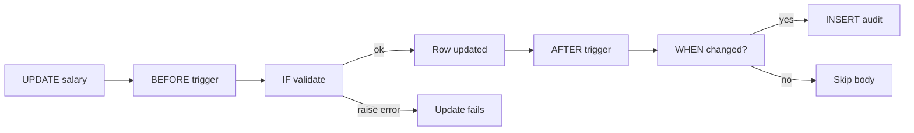

# Oracle Trigger Notes: `WHEN` vs `IF`

Short study notes for **row-level** triggers that use `:OLD` / `:NEW` (based on the salary examples in this folder).

---

## Flow overview



---

## `WHEN` clause

### What it is

A **trigger-level filter**. Oracle evaluates it **per row**, **before** the trigger body runs.

- If the condition is **true** → the body runs.
- If the condition is **false** → the body is **skipped**.
- The DML still **succeeds** when `WHEN` is false (you only skipped side effects).
- You **cannot** call `RAISE_APPLICATION_ERROR` inside `WHEN`.

### Syntax tip

In `WHEN (...)`, use `OLD` / `NEW` **without** a colon:

```sql
WHEN (NVL(OLD.salary, -1) <> NVL(NEW.salary, -1))
```

### When to use

Use `WHEN` when you want to **skip the body** unless something useful must happen — for example:

- Audit / log only when a value **actually changed**
- Avoid useless `INSERT`s or other side effects

### Use case (this project)

See [TRIGGER_AFTER_Update.sql](TRIGGER_AFTER_Update.sql):

```sql
CREATE OR REPLACE TRIGGER trg_emp_salary_audit
AFTER UPDATE OF salary ON employee
FOR EACH ROW
WHEN (NVL(OLD.salary, -1) <> NVL(NEW.salary, -1))
BEGIN
  INSERT INTO employee_salary_audit (
      empid,
      old_salary,
      new_salary
  )
  VALUES (
      :OLD.empid,
      :OLD.salary,
      :NEW.salary
  );
END;
/
```

**Why `WHEN` here?** This is an **AFTER** audit trigger. You only want a log row when salary changed (including NULL ↔ value via `NVL`). If salary is set to the same value, skip the body — no audit noise.

---

## `IF` statement

### What it is

Normal **PL/SQL** control flow **inside** `BEGIN` … `END`.

- The trigger **fires** and the body **runs**.
- Each `IF` decides what to do (allow, branch, or **abort** with an error).
- Use `:OLD` / `:NEW` **with** a colon.

### When to use

Use `IF` when you need **logic inside the body**, especially:

- Data validation
- `RAISE_APPLICATION_ERROR` to reject bad updates
- Multiple rules with different error codes / messages

### Use case (this project)

See [TRIGGER_BEFORE_Update copy.sql](TRIGGER_BEFORE_Update%20copy.sql):

```sql
CREATE OR REPLACE TRIGGER trg_emp_salary_validate
BEFORE UPDATE OF salary ON employee
FOR EACH ROW
BEGIN
  IF :NEW.salary < 0 THEN
    RAISE_APPLICATION_ERROR(-20001, 'Salary cannot be negative.');
  END IF;

  IF :NEW.salary < NVL(:OLD.salary, 0) * 0.5 THEN
    RAISE_APPLICATION_ERROR(
      -20002,
      'Salary cannot decrease by more than 50%.'
    );
  END IF;
END;
/
```

**Why `IF` here?** This is a **BEFORE** validation trigger. Bad salaries must **fail the update**. Only PL/SQL `IF` + `RAISE_APPLICATION_ERROR` can do that. Putting the rule only in `WHEN` would skip the body and still allow the bad update.

---

## The `:` (colon) — `:OLD` and `:NEW`

In a **FOR EACH ROW** trigger, Oracle gives you the before-image and after-image of the current row:

| Name | Meaning |
|------|---------|
| `OLD` / `:OLD` | Column values **before** the DML |
| `NEW` / `:NEW` | Column values **after** the DML (what you are writing) |

### Where the colon is required

| Place | Write | Example |
|-------|--------|---------|
| `WHEN (...)` | **no** colon | `OLD.salary`, `NEW.salary` |
| Trigger body / `IF` | **with** colon | `:OLD.salary`, `:NEW.salary` |

The colon tells PL/SQL these are **bind / correlation** references for the current row — not ordinary variables or table names.

**Wrong:**

```sql
WHEN (:OLD.salary <> :NEW.salary)   -- invalid in WHEN
...
IF OLD.salary < 0 THEN              -- invalid in body (use :OLD)
```

**Right:**

```sql
WHEN (OLD.salary <> NEW.salary)
...
IF :NEW.salary < 0 THEN
```

---

## Quick comparison: `WHEN` vs `IF`

| | `WHEN` | `IF` |
|---|--------|------|
| Where | On the trigger header | Inside `BEGIN` … `END` |
| Job | Filter: run body or skip | Decide: validate / raise / branch |
| Colon | `OLD` / `NEW` (no `:`) | `:OLD` / `:NEW` (with `:`) |
| Condition false | Body skipped; DML still OK | You choose (often raise → DML fails) |
| Can raise error? | No | Yes (`RAISE_APPLICATION_ERROR`) |
| Best for | Side effects only when needed | Business rules / validation |
| This folder | AFTER audit → [TRIGGER_AFTER_Update.sql](TRIGGER_AFTER_Update.sql) | BEFORE validate → [TRIGGER_BEFORE_Update copy.sql](TRIGGER_BEFORE_Update%20copy.sql) |

### Rule of thumb

- **`WHEN`** = “Should this trigger body run for this row?”
- **`IF`** = “Now that we are in the body, is the data allowed / what should we do?”

**Pattern used here:** AFTER audit → `WHEN`; BEFORE validate → `IF`.
